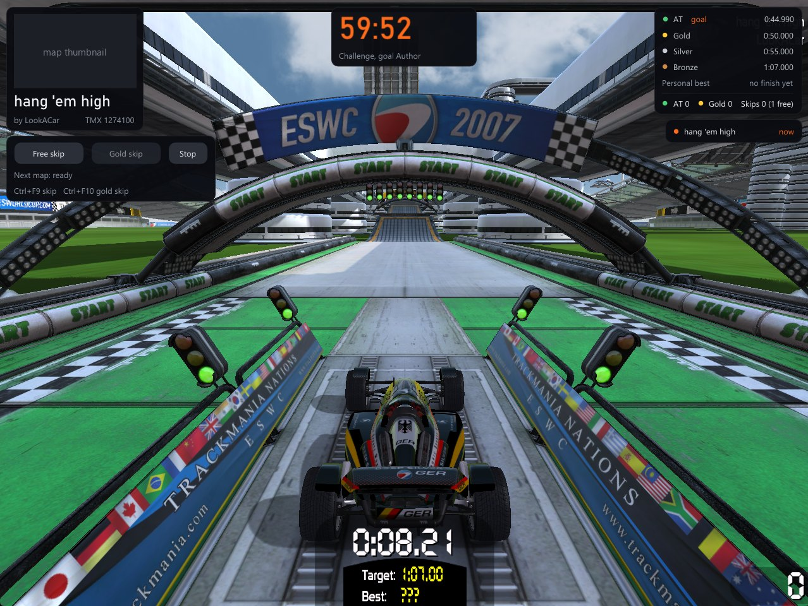
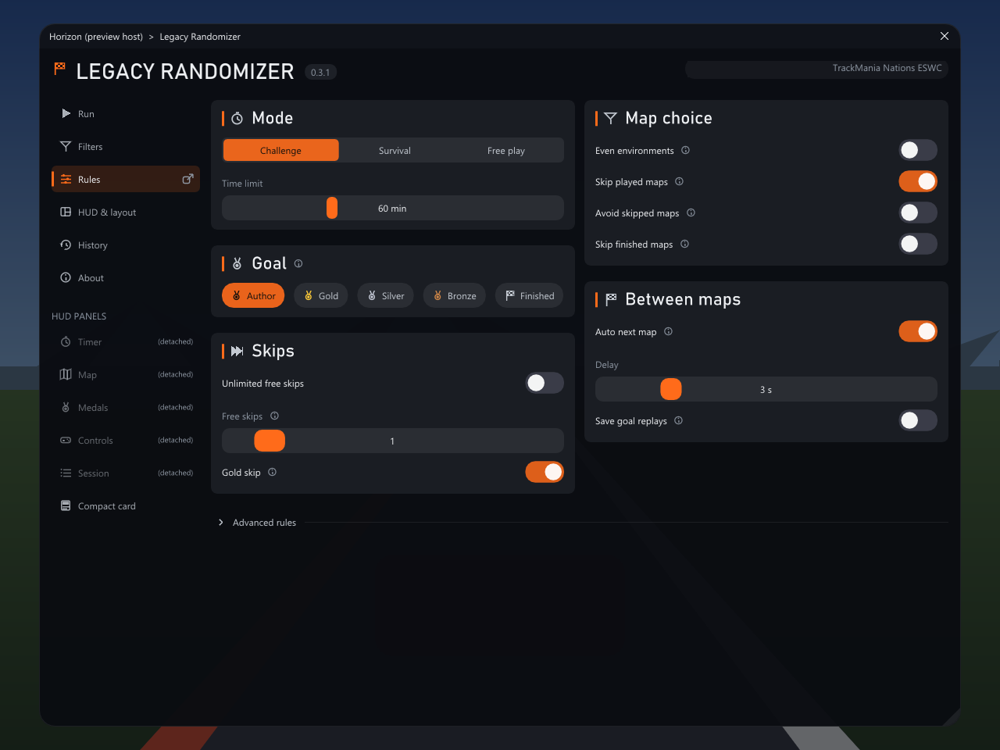

# Legacy Randomizer

A Random Map Challenge (RMC) inside old TrackMania games: TrackMania Nations ESWC, TrackMania Sunrise and TrackMania Original. Press Start, the mod loads a random map from TM Exchange, you try to reach the goal medal, then the next map comes. It runs as a plugin of the [Horizon Client](https://github.com/cheatoskar/horizon-client), solo only.

Version 0.3.1. MIT licence. Built with [Claude Code](https://claude.com/claude-code).



*A run in TrackMania Nations ESWC: timer, map, medals, skips and the maps of this run. Map: "hang 'em high" by LookACar (TMX 1274100); its thumbnail is blanked here.*



*The Rules page of the menu (preview render).*

## Supported games

- TrackMania Nations ESWC, unofficial 1.80 exe
- TrackMania Sunrise, Win10 repack (finish detection needs Horizon Client 0.3.1 or newer)
- TrackMania Original, Online Patch v2 exe: less tested

Forever (TMNF/TMUF) is not supported. Nothing runs while you are online.

## Install

**With the TM Horizon launcher:** install the game and the Horizon Client there, then the Legacy Randomizer module. See [TM Horizon](https://github.com/cheatoskar/tm-horizon).

**From the release zips** ([Releases](https://github.com/cheatoskar/legacy-randomizer/releases)):

- `LegacyRandomizer-<version>-ESWC-with-Horizon-Client.zip` and `...-Sunrise-with-Horizon-Client.zip` contain the Horizon Client and the plugin. Unzip into the game folder (next to `TmNationsESWC.exe` or `TmSunrise.exe`), double-click `Horizon-Install.cmd`, start the game and press **Insert**. An existing `dinput8.dll` of another mod is kept as `dinput8.chain.dll`.
- `LegacyRandomizer-<version>-plugin.zip` is only the plugin. If the Horizon Client is already installed, unzip it into the game folder so the files land in `horizon\plugins\legacy-randomizer\`.
- Original has no bundle: install the Horizon Client's Original zip first, then the plugin zip.

`SHA256SUMS.txt` is in the release. To uninstall, delete `horizon\plugins\legacy-randomizer`.

## How to play

1. Press **Insert**, open the Legacy Randomizer page, set filters and rules if you want.
2. Press **Start run**. The mod loads the first map; the next one is fetched in the background.
3. Reach the goal medal (Author by default) to get the next map. Skip a map you cannot do.

Modes:

- **Challenge** (RMC): collect as many goal medals as you can before the timer runs out.
- **Survival** (RMS): medals add time, skips cost time, the run ends at 0.
- **Free play**: no timer.

Goal is Author, Gold, Silver, Bronze or Finished; a better medal counts too. The first skip is free (the number can be changed). **Gold skip** (goal Author only) moves on once you have at least the gold medal and counts as a gold.

| Key | Action |
|---|---|
| Insert | Open the Horizon menu |
| Ctrl+F9 | Skip the map |
| Ctrl+F10 | Gold skip |
| Ctrl+F11 | Show or hide the HUD |

The keys can be changed in the Horizon menu.

## Settings

- **Filters:** environment, difficulty, length, mood, routes, name, author, upload date and more. Maps you played in earlier runs are not picked again (can be switched off).
- **Rules:** mode, time limit, goal, free skips, gold skip, even environments, skip played / finished maps, avoid skipped maps, automatic next map and its delay.
- **HUD & layout:** the HUD is split into Timer, Map, Medals, Controls and Session panels, or one Compact card. *Edit layout* lets you move and resize them while the menu is open; otherwise they let clicks through to the game. Panels can also be popped out as windows.
- **Hide Clock and Map Info:** during a run the Horizon Client's Clock and Map Info widgets are hidden and come back when the run ends.
- **History:** every run is saved as a JSON file with its maps and medals.

## Building

MSVC Build Tools (x86) with `vcvarsamd64_x86.bat` at the path set in `build.cmd`:

```
build.cmd
```

This builds `dist\legacy_randomizer_plugin.dll`, `dist\plugin.json`, the test `build\test\core_test.exe` and the preview tool `build\test\ui_preview.exe`. Tests: run `build\test\core_test.exe` (add `--live` for a few live TMX requests). The screenshots above: `build\test\ui_preview.exe --shots <folder> --display 1280x960`. Release zips: `scripts\package.ps1`.

Plugin details (ABI pins, code layout, panels): [docs/plugin.md](docs/plugin.md).

## Please be kind to TMX

The mod asks the TMX API for one map at a time. Please do not start many runs in a loop and do not use it to download maps in bulk.

## Credits

- Flink: the idea of the Random Map Challenge
- BigBang1112: [RandomizerTMF](https://github.com/BigBang1112/randomizer-tmf) is the model for the rules and filters; no code was taken from it
- TM Exchange: the maps, screenshots and the API
- [Dear ImGui](https://github.com/ocornut/imgui) by Omar Cornut (MIT)

## License

[MIT](LICENSE)
